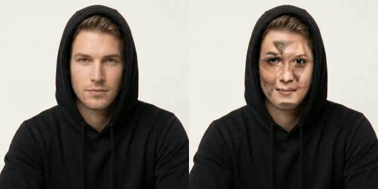
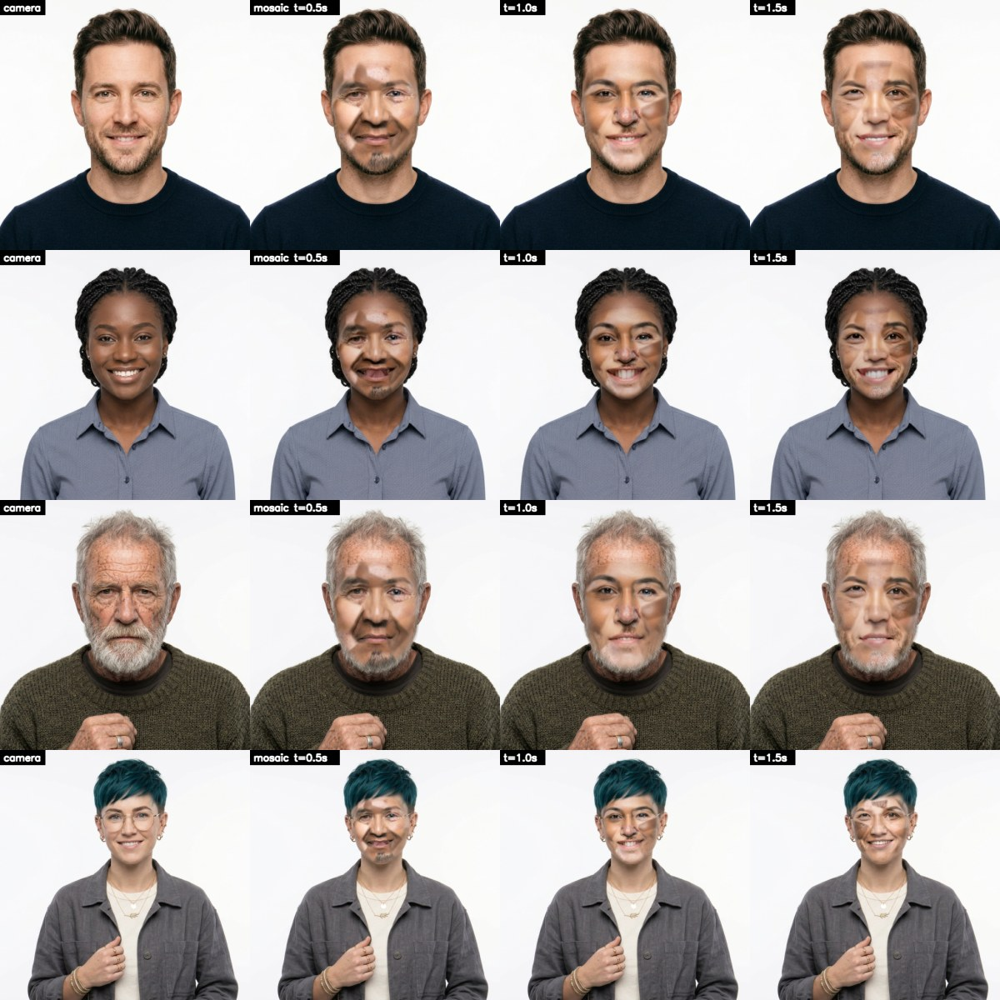
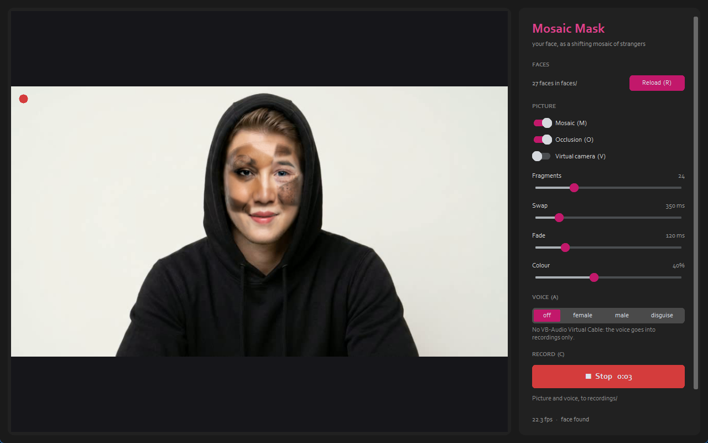

# Mosaic Mask

**Website:** https://cursedprograms.github.io/Mosaic-Mask/

A disguise for video calls: your face as a shifting mosaic of strangers. Every part of it (eyes, brows,
nose, mouth, cheeks, chin, forehead) comes from a different person and keeps changing, so nobody on the
call ever sees one face, yours included. It follows your face as you talk, turn and frown, and goes to
Zoom, Teams, Discord or Meet as an ordinary camera.

The strangers are **AI-generated people who don't exist**: no real person's face ends up in it.

Inspired by the **scramble suit** in *A Scanner Darkly* by **Philip K. Dick** (the 1977 novel, and Richard
Linklater's 2006 film of it): the undercover agents' disguise, a shroud that shows a constantly shifting
blur of thousands of different people's faces and bodies, so the wearer is nobody in particular.

## What it looks like

Each row is one face: as the camera sees it, then as the mosaic half a second, a second and a second and a
half later. Every piece follows the face's own shape, and every piece changes on its own timer, so the face
never settles. `samples/mosaic_shimmer.mp4` shows six seconds of it.

## Use it

1. Put face images in `faces/` (see [The faces](#the-faces)).
2. Start `run.bat` (or `.\run.ps1` in PowerShell, `./run.sh` in Git Bash or Linux). The first time it sets itself up: a Python 3.11 venv with MediaPipe, OpenCV and
   pyvirtualcam.
3. In your call, pick the camera **OBS Virtual Camera**. [OBS Studio](https://obsproject.com/) must be
   installed for its virtual camera; it doesn't have to be running.

The window (the Changeling look) shows what the call sees; on the right are the faces, the switches, the
sliders, the voice and **Record**.

| Key | Does |
| :--- | :--- |
| <kbd>M</kbd> | mosaic on / off (your own face, for a moment) |
| <kbd>O</kbd> | occlusion on / off: hands, hair, a cup in front of your face stay in front of the mosaic |
| <kbd>A</kbd> | voice: off, female, male, disguise (see [The voice](#the-voice)) |
| <kbd>V</kbd> | virtual camera on / off |
| <kbd>C</kbd> | record / stop: the masked picture and your voice, as one `.mp4` in `recordings/` |
| <kbd>R</kbd> | reload `faces/` (after adding images) |
| <kbd>Q</kbd> or <kbd>Esc</kbd> | quit |

| Slider | Does |
| :--- | :--- |
| fragments | how many pieces the face is cut into: more is finer and busier |
| swap ms | how often each piece changes to someone else (each a little earlier or later than the others) |
| fade ms | how long a piece blends into the next face: the shimmer |
| colour % | how much the mosaic takes on your skin tone: 0 is everyone's own skin, a patchwork |

Options: `run.bat --camera 1` (another webcam), `run.bat --source clip.mp4` (a video or a picture instead
of the webcam), `run.bat --no-virtual` (just the preview), `run.bat --source face.jpg --snapshot out.png`
(one masked frame saved to a file, for trying settings).

## The voice

Press <kbd>A</kbd> to cycle your voice: **off**, **female**, **male**, **disguise**.

| Voice | What it does |
| :--- | :--- |
| female | your voice taken to a woman's pitch (about 210 Hz), the formants (the resonance that sounds man or woman) up with it |
| male | your voice taken to a man's pitch (about 115 Hz), the formants down with it |
| disguise | pitch and formants drift slowly and at random around your own, so you sound like nobody in particular |
| off | your own voice, still through the cable, so the call's microphone doesn't change |

It's a phase vocoder working on one continuous stream: your voice's harmonics move by the pitch ratio,
its spectral envelope (the formants) by the formant ratio, and the phases carry on from one moment to the
next, so there are no seams. About a tenth of a second of delay, on the CPU. Female and male aim at a
pitch rather than a fixed step: your own pitch is learned as you talk, so a deep voice and a light one
both land in the right range.

### VB-Audio Virtual Cable, and listening to the test files

- **The cable is a sound driver:** it installs into Windows with admin rights and adds devices to your
  system. Changing your computer's drivers is your call, not something to do quietly. Without it, the
  changed voice has no way to reach Zoom, Discord or similar. Install
  [VB-Audio Virtual Cable](https://vb-audio.com/Cable/), then in your call pick **CABLE Output** as the
  microphone.
- **The test files:** the pitch is measured and correct by the numbers, but whether it *sounds* like a
  believable voice, or robotic and warbly, only your ears can judge. `voice_tests/` (on your own PC,
  not in the repo) has a recording through each voice to listen to first: a clean male test voice
  (Windows' David), then female, male and disguise.

Options: `run.bat --voice female` (start with a voice), `run.bat --mic "Focusrite"` (pick the microphone
by part of its name), `run.bat --monitor "Speakers"` (also hear yourself: use headphones, or you'll get
feedback).

## The faces

The more there are, the less any one of them shows: **100 or more** is good, a few hundred is better.
Generate them (AI Visual Workshop, Gemini...) rather than using photos of real people: a disguise made of
real people's faces isn't fair on them. Any size; `.png`, `.jpg`, `.webp` or `.jfif`. Name each file by
what's in it (`woman_elderly_short_grey_hair_olive_shirt.jfif`): easy to find, easy to leave out.

What works best:

- looking at the camera (a slight turn is fine), the whole face visible: no hands, hair or glasses over
  the eyes or mouth
- even light, no hard shadow across half the face
- neutral or a slight smile, mouth closed or barely open
- every age, skin tone and gender: the mix is the point

Images with no face found are skipped; `faces/_canon/pool.json` lists which and why. `faces/_canon/` is a
cache (each face unwrapped onto the shared layout), made again whenever it needs to be.

## How it works

1. **The face pool.** Every image in `faces/` is read once: MediaPipe Face Mesh finds 468 points on the
   face, and the face is unwrapped onto one shared layout (the pool's average face, eyes and mouth in the
   same places). After that a piece of any face lines up with the same piece of any other.
2. **The mosaic.** The shared face is cut into pieces like a patchwork (a Voronoi map around the eyes,
   brows, nose, mouth, cheeks, chin, jaw, temples and forehead, plus more scattered between them). Each
   piece shows a different face, picks a new one every *swap ms* (each a little early or late), and
   blends into it over *fade ms*.
3. **Onto you.** Every frame, Face Mesh finds your face, and the patchwork is warped onto it triangle by
   triangle, so the borrowed mouth moves with yours. Its colour is pulled towards your skin by *colour %*,
   and its edge is feathered into your head.
4. **Out.** The finished frame goes to the preview and to OBS's virtual camera (pyvirtualcam).

About 30 fps at 720p on the CPU: only the face's box is worked on, and the shared face's side of the warp
is worked out once.

| File | What it is |
| :--- | :--- |
| `app.py` | the webcam, the face pool, the occlusion and the voice; starts the window |
| `window.py` | the window: the picture, the switches and sliders, the voice, Record, the virtual camera |
| `recorder.py` | Record: the picture at a steady 30 fps and the voice, joined by ffmpeg |
| `mosaic/mesh.py` | Face Mesh, the lighter set of points the warp follows, the triangle warp |
| `mosaic/face_pool.py` | the faces in `faces/`, unwrapped onto the shared layout and cached |
| `mosaic/suit.py` | the patchwork, each piece's timer and fade, colour, and the warp onto the live face |
| `run.bat` | sets up the venv and starts the app |
| `make_samples.py` | makes the GIF, the sample sheet and the clip again from `faces/` (after adding faces) |
| `samples/` | the GIF, the sample sheet and the clip above |
| `TODO.md` | what's next: the body and clothes, a drifting voice, calmer mouths, more faces |

---

 

© Cursed Entertainment 2026

 

 

  

